# AEGIS: A Self-Learning AI Agent

**An AI agent platform designed to process tasks, use tools, learn from feedback, and maintain persistent user-specific memory.**

[GitHub Repository](https://github.com/ASAD1960/AEGIS) · [Live Application](https://aegis-cyan-phi.vercel.app/) · [Developer Profile](https://github.com/ASAD1960)

---

## Introduction

**AEGIS** is a self-learning AI agent platform developed to explore how AI agents can process user requests, interact with tools, maintain contextual information, and improve their approach through feedback.

Unlike a basic conversational application, AEGIS combines an agent-processing architecture with tool integration, conversation management, feedback analysis, benchmarking, and persistent personal memory.

The project explores the following research question:

> Can feedback-driven adaptation improve an AI agent's task success while reducing repeated errors?

AEGIS is designed as a modular research and engineering project. Its architecture separates the frontend, backend API, agent engine, language model providers, tools, learning components, and persistence layer.

## Project Links

| Resource | Link |
|---|---|
| GitHub Repository | [ASAD1960/AEGIS](https://github.com/ASAD1960/AEGIS) |
| Live Application | [Open AEGIS](https://aegis-cyan-phi.vercel.app/) |
| Developer Profile | [Asad Yar](https://github.com/ASAD1960) |

## Technology Stack

| Component | Technologies |
|---|---|
| Backend | Python, FastAPI, Pydantic, Uvicorn |
| Frontend | Next.js 16, React 19, TypeScript |
| Styling | Tailwind CSS 4 |
| AI Integration | Cloudflare Workers AI, Ollama |
| Authentication | Supabase Auth |
| Database | SQLite, PostgreSQL support |
| Data Processing | Python, CSV workflows |
| Testing | Pytest, TypeScript Compiler |
| Deployment | Vercel, configurable backend hosting |
| Development Tools | Git, GitHub, Visual Studio Code |

## Key Features

### 1. AI Agent and Task Processing

AEGIS processes user requests and determines an appropriate execution path.

Current capabilities include:

- Conversational request processing.
- Task identification and routing.
- Tool selection and execution.
- Language model integration.
- Context-aware response generation.
- Conversation history support.

### 2. Tool Integration

AEGIS uses a modular tool architecture.

Available tool categories include:

- **Calculator:** Mathematical calculations.
- **Text Processing:** Basic text-related operations.
- **Data Analysis:** Data analysis workflows.
- **CSV Processing:** Processing uploaded CSV data.

The modular structure allows additional tools to be integrated without redesigning the entire agent architecture.

### 3. Multiple Language Model Providers

AEGIS supports two language model integration options:

- **Cloudflare Workers AI:** Connects the agent to cloud-hosted language models.
- **Ollama:** Supports locally running language models.

The provider-based architecture allows the application to use different model execution environments.

### 4. Persistent Personal Memory

AEGIS includes a persistent personal memory system designed to retain relevant user-provided information across conversations.

Unlike ordinary conversation history, personal memories are stored separately and can be retrieved when generating responses in future conversations.

Current capabilities include:

- User-specific memory storage.
- Automatic extraction of supported explicit personal statements.
- Memory categorization.
- Memory retrieval across conversations.
- Memory history and version tracking.
- Corrections to previously stored information.
- Memory deletion.
- Separation of personal memory from conversation history.
- SQLite and PostgreSQL storage implementations.

#### Memory Versioning and Corrections

When a user corrects an existing stored fact, AEGIS can replace the active version while retaining the previous version as superseded history.

For example:

| Event | Stored information |
|---|---|
| Initial statement | The user enjoys Python. |
| Correction | The user does not enjoy Python. |
| Current memory | The user does not enjoy Python. |
| Previous version | Retained as superseded history. |

This approach helps prevent outdated personal information from being treated as current.

Memory records are associated with authenticated user identities to support user-specific data separation.

### 5. Authentication and Data Ownership

AEGIS integrates Supabase Authentication for user authentication.

The backend:

- Validates authentication tokens.
- Identifies authenticated users.
- Associates conversations with user identities.
- Associates personal memories with user identities.
- Applies user ownership checks to memory and conversation operations.

Authentication and ownership checks are part of the backend API architecture.

### 6. Conversation Management

AEGIS supports persistent conversation management.

Features include:

- Creating conversations.
- Saving conversation messages.
- Retrieving previous conversations.
- Opening existing conversations.
- Deleting conversations.
- Maintaining user-specific conversation records.

Conversation history and persistent personal memory are maintained as separate data systems.

### 7. Feedback and Learning Components

AEGIS includes a feedback-based learning architecture intended to analyze user evaluations and support improvements in future task execution.

Current components include:

- Feedback collection and storage.
- Feedback analysis.
- Performance-based selection components.
- Learning strategy components.
- Integration with the agent workflow.

The effectiveness of feedback-driven adaptation remains a research question requiring controlled experiments and measurable evaluation.

### 8. Benchmarking and Evaluation

AEGIS includes a modular benchmarking framework for structured agent evaluation.

Its components include:

- Benchmark dataset generation.
- Scenario families.
- Dataset validation.
- Dataset splitting.
- Dataset processing pipelines.
- Benchmark execution.
- Performance evaluation.
- Analytics and experiment storage.

The framework provides a foundation for evaluating agent behavior across different scenarios.

### 9. Web Interface

The frontend provides the main interface for interacting with AEGIS.

Current interface capabilities include:

- Conversational interaction.
- Conversation history.
- Creating and deleting conversations.
- Application and system status information.
- Tool information.
- Light appearance.
- Dark appearance.
- System appearance preference.

---

## Screenshots

This section showcases the AEGIS user interface, application design, and example interactions. Each screenshot highlights a different part of the platform.

### 1. Login Screen

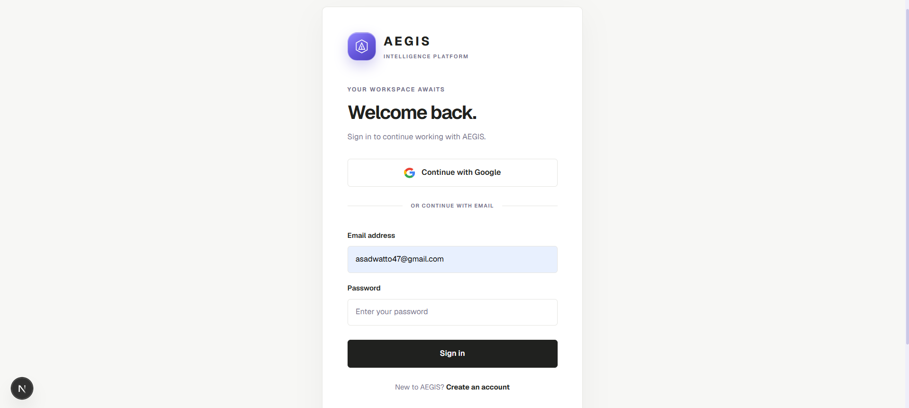

The login screen provides an authentication entry point for users. It allows users to access their accounts and enter the AEGIS application through its authentication system.

### 2. Home Screen

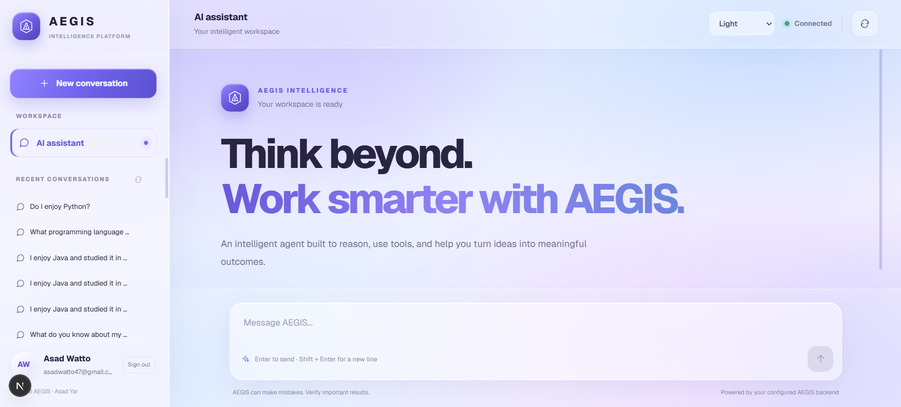

The home screen introduces the AEGIS platform and provides the starting point for interacting with the AI agent. It serves as the main entry point to the application.

### 3. Dashboard

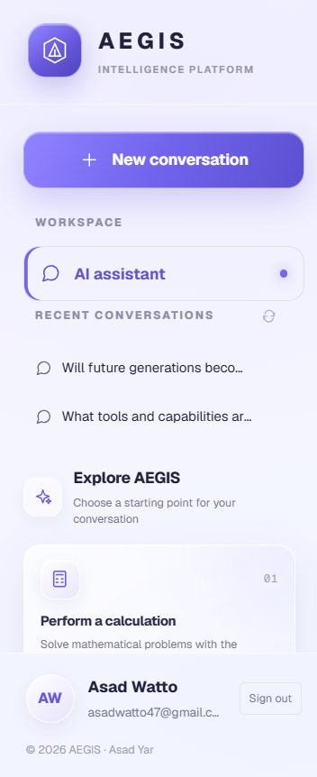

The dashboard brings together important application information and provides users with an overview of the AEGIS environment and its available features.

### 4. Dark Mode

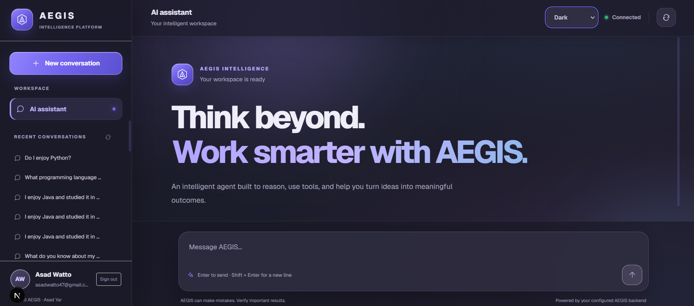

AEGIS includes a dark appearance option to provide an alternative visual experience. This allows users to choose an interface appearance according to their viewing preferences.

### 5. Prompting First Interaction

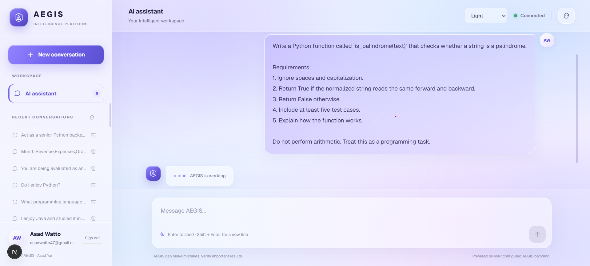

This screenshot demonstrates how users communicate with AEGIS through natural-language prompts. Users can describe their questions or tasks without needing to use a fixed command format.

### 6. Result First Response

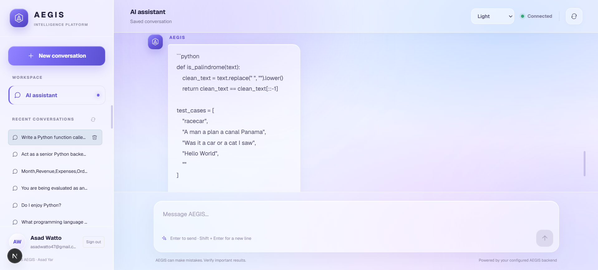

This screenshot presents the result of the first interaction. It demonstrates how AEGIS interprets a user request and generates a relevant response.

### 7. Prompting Second Interaction

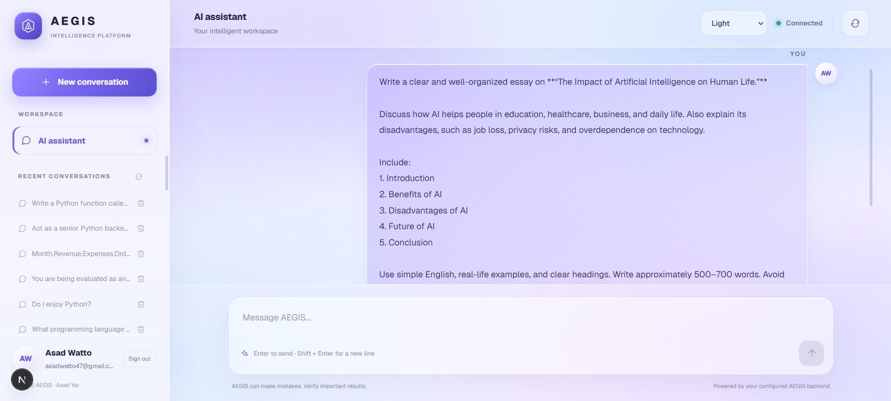

The second prompting example demonstrates another interaction with the agent. It highlights the ability to submit different questions and instructions through the same conversational interface.

### 8. Result Second Response

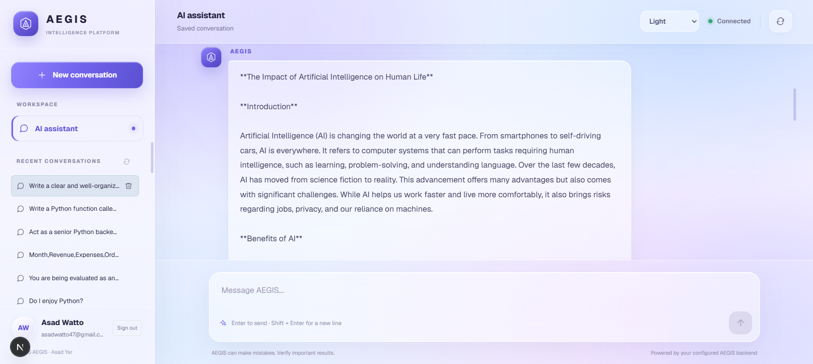

This screenshot shows the response generated from the second interaction. It provides an additional example of AEGIS's natural-language response generation.

### 9. Can AI Replace Human Intelligence?

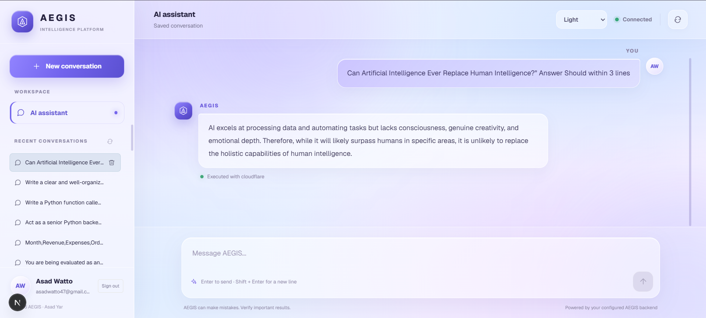

This example explores the relationship between artificial intelligence and human intelligence. It considers AI's strengths in data processing and automation alongside human creativity, emotional understanding, and judgment.

### 10. Will Future Generations Become Too Dependent on Technology?

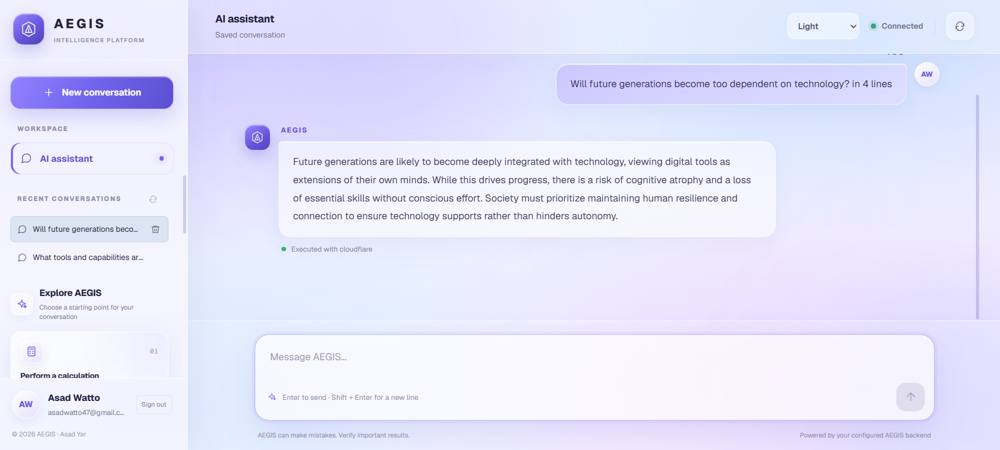

This interaction explores the possible effects of technological dependence on future generations. It demonstrates AEGIS's ability to discuss broader social questions and present a reasoned response.

### 11. Copyright and Project Attribution

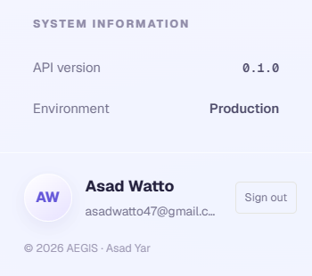

This final screenshot presents the copyright and project attribution for AEGIS, recognizing **Asad Yar** as the developer of the project.

---

## System Architecture

AEGIS follows a modular architecture that separates the frontend, API, agent engine, language model integration, tools, learning components, and persistence.

```text
                    USER
                      |
                      v
              NEXT.JS FRONTEND
                      |
                      v
                   FASTAPI
                      |
                      v
                AUTHENTICATION
                      |
                      v
                   AI AGENT
                      |
          +-----------+-----------+
          |           |           |
          v           v           v
        TASK        TOOL          LLM
     PROCESSING   SELECTION   INTEGRATION
                      |
                      v
                TOOL EXECUTION
                      |
          +-----------+-----------+
          |           |           |
          v           v           v
      CALCULATOR    TEXT      DATA ANALYSIS
                   TOOLS
                      |
                      v
                  TASK RESULT
                      |
                      v
                 USER FEEDBACK
                      |
                      v
              LEARNING COMPONENTS
                      |
                      v
              PERFORMANCE ANALYSIS

             DATABASE AND PERSISTENCE
                      |
          +-----------+-----------+
          |           |           |
          v           v           v
     Conversations  Personal   Feedback
                     Memories   Records
          |
          v
    Benchmark Experiments
```

## Persistent Memory Architecture

The personal memory implementation uses a database-backed architecture.

The storage layer supports:

- SQLite for local development.
- PostgreSQL through a configurable database connection.

Each memory record contains information such as:

| Field | Purpose |
|---|---|
| `id` | Memory identifier |
| `user_id` | Associated authenticated user |
| `memory_key` | Stable memory identity |
| `content` | Stored information |
| `category` | Memory category |
| `source_type` | Statement or correction provenance |
| `source_text` | Original supporting text |
| `status` | Active or superseded |
| `created_at` | Creation timestamp |
| `updated_at` | Update timestamp |

Memory operations include saving, retrieving, updating through versioning, reviewing history, and deleting records.

Personal memory is supplied to the language model separately from conversation history, allowing relevant stored information to be used in future interactions.

## Project Structure

The following is a simplified overview of the repository.

```text
AEGIS/
│
├── app/
│   ├── agent/
│   │   ├── agent.py
│   │   ├── executor.py
│   │   ├── identity.py
│   │   ├── task_parser.py
│   │   └── tool_selector.py
│   │
│   ├── api/
│   │   └── main.py
│   │
│   ├── benchmark/
│   │   ├── analytics.py
│   │   ├── dataset.py
│   │   ├── dataset_generator.py
│   │   ├── dataset_pipeline.py
│   │   ├── dataset_splitter.py
│   │   ├── dataset_validator.py
│   │   ├── evaluator.py
│   │   ├── runner.py
│   │   ├── scenario_families.py
│   │   └── storage.py
│   │
│   ├── core/
│   │   └── config.py
│   │
│   ├── learning/
│   │   ├── analyzer.py
│   │   ├── feedback.py
│   │   ├── selector.py
│   │   └── strategy.py
│   │
│   ├── llm/
│   │   ├── cloudflare_client.py
│   │   └── ollama_client.py
│   │
│   ├── memory/
│   │   ├── database.py
│   │   ├── database_backend.py
│   │   ├── extraction.py
│   │   └── postgres_backend.py
│   │
│   ├── tools/
│   │   ├── base.py
│   │   ├── calculator_tool.py
│   │   ├── data_analysis_tool.py
│   │   ├── registry.py
│   │   └── text_tool.py
│   │
│   └── main.py
│
├── frontend/
│   └── src/
│       ├── app/
│       │   ├── globals.css
│       │   ├── layout.tsx
│       │   └── page.tsx
│       └── lib/
│           └── supabase.ts
│
├── tests/
├── data/
├── docs/
│   └── screenshots/
│
├── requirements.txt
├── README.md
└── .gitignore
```

## Database and Persistence

AEGIS supports SQLite and PostgreSQL through its database abstraction layer.

Stored application data includes:

- Conversation records.
- Conversation messages.
- Personal memory records.
- Personal memory history.
- Feedback records.
- Benchmark and experiment records.

### SQLite

SQLite is the default database option for local development.

### PostgreSQL

PostgreSQL can be configured using:

```text
AEGIS_DATABASE_URL
```

The PostgreSQL implementation includes user-scoped memory operations and version handling.

**Note:** The PostgreSQL implementation has automated mocked tests, but a real PostgreSQL server integration test has not yet been completed.

---

## Installation and Setup

### Prerequisites

Install:

- Python.
- Node.js and npm.
- Git.
- Visual Studio Code or another code editor.

### 1. Clone the Repository

```powershell
git clone https://github.com/ASAD1960/AEGIS.git
cd AEGIS
```

### 2. Create a Python Virtual Environment

```powershell
python -m venv .venv
```

Activate the environment in PowerShell:

```powershell
Set-ExecutionPolicy -Scope Process -ExecutionPolicy Bypass
.\.venv\Scripts\Activate.ps1
```

### 3. Install Backend Dependencies

```powershell
pip install -r requirements.txt
```

### 4. Configure Environment Variables

Configure the required backend environment variables.

For Cloudflare Workers AI:

```powershell
$env:CLOUDFLARE_ACCOUNT_ID="your_account_id"
$env:CLOUDFLARE_API_TOKEN="your_api_token"
```

For Supabase authentication:

```powershell
$env:SUPABASE_URL="your_supabase_project_url"
$env:SUPABASE_PUBLISHABLE_KEY="your_supabase_publishable_key"
```

For PostgreSQL, if required:

```powershell
$env:AEGIS_DATABASE_URL="your_database_connection_string"
```

SQLite can be used without configuring PostgreSQL.

Ollama can be configured separately for local model integration.

### 5. Configure Frontend Environment Variables

Create or configure:

```text
frontend/.env.local
```

Add the Supabase frontend configuration:

```env
NEXT_PUBLIC_SUPABASE_URL=your_supabase_project_url
NEXT_PUBLIC_SUPABASE_ANON_KEY=your_supabase_publishable_key
```

Use the appropriate public Supabase key for the project.

Never place service-role keys, private API tokens, or database passwords in frontend environment variables.

### 6. Install Frontend Dependencies

Open another PowerShell terminal:

```powershell
cd frontend
npm.cmd install
```

---

## Running AEGIS Locally

### Start the Backend

From the project root:

```powershell
python -m uvicorn app.api.main:app --reload --host 127.0.0.1 --port 8001
```

Backend:

```text
http://127.0.0.1:8001
```

API documentation:

```text
http://127.0.0.1:8001/docs
```

### Start the Frontend

Open another terminal:

```powershell
cd frontend
npm.cmd run dev -- --port 3000
```

Frontend:

```text
http://localhost:3000
```

---

## API Endpoints

The backend exposes endpoints for health checks, application status, agent interaction, tools, data uploads, conversations, and personal memory.

| Method | Endpoint | Purpose |
|---|---|---|
| GET | `/api/health` | Health check |
| GET | `/api/status` | Application status |
| GET | `/api/tools` | Available tools |
| POST | `/api/tasks` | Submit an agent task |
| POST | `/api/data/upload` | Upload data |
| GET | `/api/conversations` | Retrieve conversations |
| GET | `/api/conversations/{conversation_id}/messages` | Retrieve conversation messages |
| DELETE | `/api/conversations/{conversation_id}` | Delete a conversation |
| GET | `/api/memories` | Retrieve active personal memories |
| GET | `/api/memories/{memory_key}/history` | Retrieve memory version history |
| POST | `/api/memories` | Create a personal memory |
| DELETE | `/api/memories/{memory_id}` | Delete a personal memory |

For the latest request formats and API behavior, use the FastAPI documentation:

```text
http://127.0.0.1:8001/docs
```

---

## Testing and Quality Assurance

AEGIS includes automated tests for its backend functionality, memory operations, agent processing, API routes, and other application components.

### Run the Complete Test Suite

From the project root:

```powershell
python -m pytest
```

For detailed output:

```powershell
python -m pytest -v
```

### Check Frontend TypeScript

From the frontend directory:

```powershell
npx tsc --noEmit
```

### Build the Frontend

```powershell
npm.cmd run build
```

### Latest Verified Test Result

| Metric | Result |
|---|---|
| Automated tests passed | 558 |
| Full test suite | Passed |
| Production frontend build | Passed |
| Live frontend deployment | Ready |
| Persistent memory retrieval | Verified |
| Memory correction handling | Verified |

The 558-test result reflects the latest full local test run. It should not be interpreted as a real PostgreSQL integration test or a formal security audit.

---

## Production Deployment

The AEGIS frontend is deployed through Vercel.

**Production application:**

[https://aegis-cyan-phi.vercel.app/](https://aegis-cyan-phi.vercel.app/)

The production frontend integrates with the configured backend and Supabase authentication.

### Production Configuration

The application uses environment variables for:

- Supabase project URL.
- Supabase publishable key.
- Cloudflare account configuration.
- Cloudflare API token.
- Database connection configuration.
- Language model provider selection.

Production credentials must be configured through the hosting platform's environment-variable settings.

Never commit real credentials or database connection strings to the repository.

---

## Research Direction

AEGIS is being developed around the following research question:

> Can feedback-driven adaptation improve an AI agent's task success while reducing repeated errors?

The research direction includes:

1. Establishing baseline agent performance.
2. Collecting feedback from task execution.
3. Analyzing feedback and identifying recurring problems.
4. Exploring feedback-based strategy selection.
5. Evaluating performance across benchmark scenarios.
6. Comparing results to investigate whether feedback-based adaptation produces measurable improvements.

The benchmarking framework provides a foundation for structured and reproducible experiments.

The persistent memory system also introduces a separate engineering direction: investigating how user-specific information can be stored, corrected, retrieved, and incorporated into future agent interactions.

---

## Current Limitations

AEGIS is an actively developing project. Its current implementation should be distinguished from its future research objectives.

Known limitations and areas requiring further validation include:

- Feedback-based improvement has not yet been established as a proven performance gain.
- Broader benchmark experiments are needed for reliable performance comparisons.
- Real PostgreSQL integration testing remains outstanding.
- Cross-user isolation should receive further testing against a running production database.
- Advanced autonomous multi-step planning requires further development.
- Tool permission management and stronger execution safeguards need additional work.
- Production security, scalability, and operational monitoring require continued hardening.

These limitations define areas for future development and research.

---

## Development Roadmap

| Area | Planned Improvements |
|---|---|
| Agent Intelligence | More capable task planning and execution |
| Memory | Improved contextual retrieval and memory management |
| Learning | More effective feedback-driven adaptation |
| Tool System | Additional tools and integrations |
| Evaluation | Larger benchmark datasets and controlled experiments |
| Safety | Stronger tool permissions and execution controls |
| Performance | Improved reliability and efficiency |
| Research | Reproducible experiments and documented results |
| Database | Real PostgreSQL integration and isolation testing |

---

## Author

**Asad Yar**

Computer Science Graduate
Developer and Researcher

GitHub: [@ASAD1960](https://github.com/ASAD1960)

---

## Copyright

**AEGIS: A Self-Learning AI Agent**

Developed by **Asad Yar**.

© 2026 Asad Yar. All rights reserved.

This project represents independent development and research into AI agents, tool integration, feedback-based adaptation, persistent personal memory, and performance evaluation.
